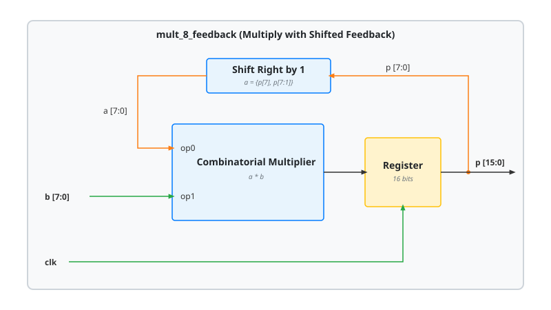

.. _datasheet_dsp_mult_8_feedback:

mult_8_feedback
---------------

Introduction
~~~~~~~~~~~~

The ``mult_8_feedback`` module multiplies two 8-bit unsigned operands and registers the 16-bit product ``p``. Operand ``a`` is not an input: it is the low byte of the registered product, shifted right by one bit with sign extension (``a = {p[7], p[7:1]}``). Operand ``b`` is an input.

When the design is mapped onto a hard multiplier with an output register, the registered product has to reach the operand port through the shift. The two top bits of ``a`` are the same signal, ``p[7]``. This exercises how a tool handles a feedback path on which a bit of a register drives the operand bit of the same index and its neighbor.

The product register has no reset. A testbench has to load a start value into ``p``.

Source Codes
~~~~~~~~~~~~

See details in ``dsp/mult/mult_8_feedback``

Block Diagram
~~~~~~~~~~~~~

  mult_8_feedback schematic

Ports
~~~~~

.. list-table:: Module Ports
  :header-rows: 1
  :class: longtable

  * - Port Name
    - Direction
    - Width
    - Description
  * - ``clk``
    - Input
    - 1
    - Clock of the product register, active at rising edge.
  * - ``b``
    - Input
    - 8
    - Operand of the multiplier.
  * - ``p``
    - Output
    - 16
    - Registered product ``a * b``, where ``a = {p[7], p[7:1]}``.

Performance
~~~~~~~~~~~

Same multiplier as an 8-bit pipelined multiplier (see :ref:`datasheet_mult_N_pipelined`), without the input registers.

.. warning:: The following resource utilization is just an estimation! Different tools in different versions may result differently.

.. list-table:: Estimated Resource Utilization
  :header-rows: 1
  :class: longtable

  * - Benchmark
    - Inputs
    - Outputs
    - LUT5
    - FF
    - Carry
    - DSP
    - BRAM
  * - mult_8_feedback
    - 9
    - 16
    - ~40
    - 16
    - 0
    - 1
    - 0
